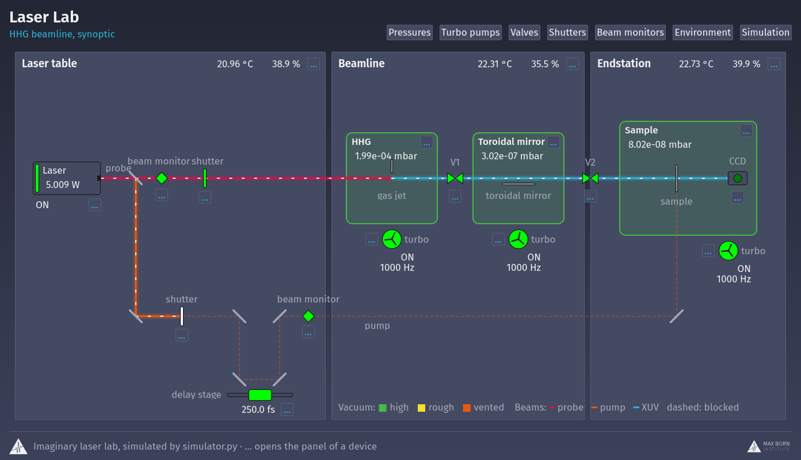

# pydm-mbi

Shared [PyDM](https://github.com/slaclab/pydm) parts for the labs of MBI division B:

- **Stylesheets** (`style/`): generated from the design tokens, which follow the MBI design guide and
  slide template (Fira Sans, base color `#3C415A`, highlight colors blue, cyan, magenta, violet).
  Dark is the default (`mbi.qss`, slate background with a slight vertical gradient, as in the slides),
  for the usually dark laser labs; `mbi-light.qss` is the light variant.
- **Logos** (`assets/logos/`): the MBI logo variants A to F, white (dark backgrounds) and blue (light ones),
  English and German, with the text converted to paths. `pydm_mbi.logo("C", "white", "en")` gives the path,
  e.g. for a `PyDMDrawingImage`.
- **Widgets** (`widgets/`): `TangoStateLed` (a LED in the Tango state colors), `MbiHeartbeat`,
  `MbiDeviceFooter` (heartbeat, state LED and status of a device, the footer of device panels) and the synoptic
  building blocks `MbiVacuumChamber`, `MbiStateSymbol` and `MbiBeam`. They show up in Qt Designer under "MBI Div B".
- **Components** (`components/`): `.ui` files per Tango device class, addressed with the macro `${DEVICE}`,
  to embed in lab displays.

Lab and experiment displays (synoptics etc.) live in their own repositories and depend on a pinned
version of this package. [`examples/laserlab`](examples/laserlab) is a complete example to start from: a
synoptic, device panels and device groups for an imaginary laser lab, with simulated devices.



## Installation

```bash
mamba install -c conda-forge pydm-mbi        # once released, see recipe/
# development
pip install --no-deps -e .
```

The conda package sets `PYDM_STYLESHEET`, `PYDM_STYLESHEET_INCLUDE_DEFAULT` and `PYDM_DISPLAYS_PATH` on
activation (`PYDM_MBI_THEME=light` before activating for the light stylesheet). Otherwise start through
the launcher:

```bash
pydm-mbi run my_display.ui            # pydm with the MBI environment, without PyDM's bars (--bars keeps them)
pydm-mbi designer [--light]           # Qt Designer with the MBI stylesheet and components path
eval "$(pydm-mbi env)"                # or set the variables in the current shell
```

`pydm-mbi run` hides the navigation, menu and status bar, also in the windows a display opens (e.g. device
panels): the displays fill the window like an application. Ctrl+M shows the menu bar again, and from its
View menu the other bars. Plain `pydm` keeps the bars.

PyDM needs the Tango data plugin (slaclab/pydm#1360). Until it is released, install pydm from the
`tango_commands` branch of https://github.com/dschick/pydm.

## Heartbeat


`MbiHeartbeat` (Designer group "MBI Div B") is the logo symbol with a light pulse propagating through its
pulse-shaped gap. Put it in a corner of every panel, like the logo in the footer of the MBI slides.

The pulse runs every `interval` ms (default 5 s, `pulseDuration` 1.5 s) on the GUI's own timer: if
nothing moves any more, the panel is frozen. With a `channel`, the gap shows the device:

| Device | Gap | Pulse |
|---|---|---|
| fine (ON, MOVING, STANDBY, ...) | dark | cyan |
| ALARM or FAULT, or an attribute with quality WARNING or ALARM | steady magenta | keeps running |
| no connection | blinking magenta | none |

The `channel` is a device, e.g. `tango://${DEVICE}` (its `State` is used), or any attribute (its quality
counts). The Tango plugin detects a lost connection for event-driven attributes too (Tango's event
heartbeat), so a rarely changing attribute such as `State` is fine.

## Using a component

Add a `PyDMEmbeddedDisplay` to the display in Designer and set

- `filename`: `tangotest/compact.ui` (found through `PYDM_DISPLAYS_PATH`)
- `macros`: `{"DEVICE": "sys/tg_test/1"}`

## Adding a component

1. `components/<device class>/<variant>.ui`, e.g. `motor/compact.ui`, `motor/expert.ui`.
2. Use `tango://${DEVICE}/...` for every channel; document further macros in a comment at the top.
3. Use roles instead of local stylesheets: dynamic property `mbiRole` = `title`, `heading`, `subheading`,
   `caption`, `value`, `unit`, `message` (bar on the left), `important` (filled magenta) for labels,
   `panel` and `separator` for frames, `primary` and `open` (compact `…` button opening a device panel)
   for buttons.
4. The tests load every component, and with Tango running check that every channel connects.
   Components for other device classes need their device server in `ci/docker-compose.yml`.

Renaming a component or a macro breaks the displays that use it: release it as a new major version.

## Changing the style

Edit `src/pydm_mbi/style/tokens.py` or `mbi.qss.in`, then regenerate the stylesheets:

```bash
python -m pydm_mbi.style
```

## Tests

```bash
docker compose -f ci/docker-compose.yml up -d     # Tango + TangoTest, optional
export TANGO_HOST=localhost:10000
python examples/laserlab/simulator.py &           # laser lab devices, optional
QT_QPA_PLATFORM=offscreen pytest
```

Tests marked `tango` are skipped without a Tango database at `TANGO_HOST`, tests marked `laserlab` without
the laser lab simulator.

## Releases

Semantic versioning, tags `vX.Y.Z`. Lab repositories pin the major version, e.g. `pydm-mbi 1.*`.

Distribution through conda-forge: release on PyPI, then submit `recipe/recipe.yaml` (with the sha256 of
the sdist) to conda-forge/staged-recipes. Afterwards the feedstock's bot picks up new PyPI releases.
This needs a pydm release on conda-forge that contains the Tango data plugin.
