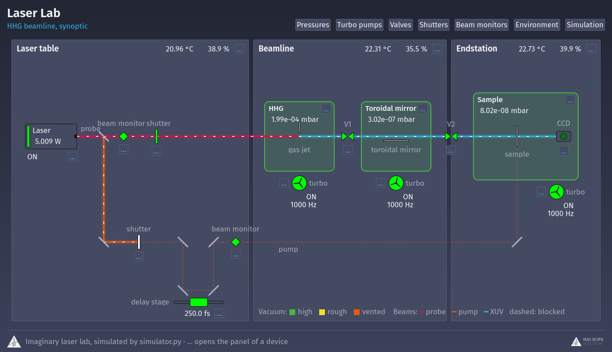
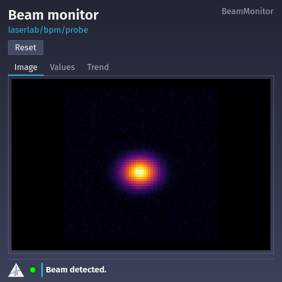

# Laser lab example

An imaginary laser lab as a template for lab displays: a synoptic as entry point, a panel per device
class and group panels for the device classes that occur more than once. The devices are simulated by a
Tango device server, so everything runs without hardware.



## Run it

```bash
docker compose -f ci/docker-compose.yml up -d     # Tango database (and TangoTest)
export TANGO_HOST=localhost:10000
python examples/laserlab/simulator.py &           # registers and serves the laserlab/* devices
pydm-mbi run examples/laserlab/laserlab.ui
```

Click **Simulation** in the synoptic to inject faults (or reset them). Stop a turbo pump and watch the
pressure rise, the chamber change color, the valves close by interlock and the XUV beam disappear.

## What is where

| File | What |
|---|---|
| `laserlab.ui` | Synoptic: laser, probe beam to the HHG source, toroidal mirror and sample chamber, pump beam over the delay stage. A `…` button next to every device opens its panel, the buttons in the header open the device groups. |
| `panels/<class>/panel.ui` | Device panel, macro `DEVICE` only: device type as title, device name below, commands, tabs with values (and setpoints), trend and, for cameras, the image; footer with heartbeat, state LED and status (`MbiDeviceFooter`). |
| `panels/<class>/row.ui` | One device in a group: state, label, device name, main values, `…` opening its panel. Macros `DEVICE`, `LABEL`. |
| `group.ui` | Device group: a `PyDMTemplateRepeater` with one row per device. Macros `TITLE`, `ROW` (row template) and `DEVICES` (list). |
| `lists/*.json` | The devices: `DEVICE`, `LABEL` and Tango `CLASS`. Read by the group panels and the simulator, so a device is added in one place. |
| `simulation.ui` | Fault injection for every simulated device. |
| `simulator.py` | The simulated devices, all in one device server `LaserLabSim/laserlab`. |



Device classes: `Laser`, `ThorlabsMFF` (shutter), `VacuumValve`, `PressureGauge`, `TurboPump`,
`TempHumiditySensor`, `BeamMonitor`, `Camera` (in-vacuum CCD) and `DelayStage`. Their attributes and
commands are made up; for a real device server, adapt the channels of its panel and row, and move them
to `src/pydm_mbi/components/<class>/` once they are shared between labs.

## Synoptic building blocks

The synoptic is a plain widget without layout, with the widgets of the "MBI Div B" group placed on it:

- `MbiVacuumChamber`: outline colored by the pressure attribute in `channel`: green up to `highVacuum`,
  yellow up to `roughVacuum`, orange above, grey without connection.
- `MbiStateSymbol`: `symbol` valve, shutter, pump, camera, monitor, laser or stage in the Tango color of the
  device state (`channel`: the device, e.g. `tango://laserlab/valve/hhg_tm`); mirror and sample without channel.
  A running turbo pump turns its rotor.
- `MbiBeam`: a straight beam segment in `direction` (right, left, down, up), animated while all `gates` pass
  (state ON, OPEN or RUNNING by default, see `passStates`), dashed while one blocks. A segment behind a
  shutter has the laser and the shutter as gates, a segment behind a valve the valve as well.

Beams go first (below), then chambers and symbols, then labels and buttons. The `…` buttons are
`PyDMRelatedDisplayButton`s with `mbiRole` = `open`, filename `panels/<class>/panel.ui` and macros
`{"DEVICE": "..."}`, opening the panel in a new window.
